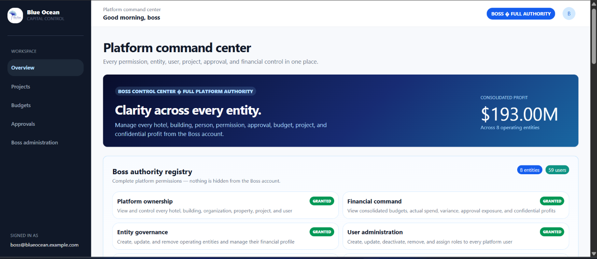
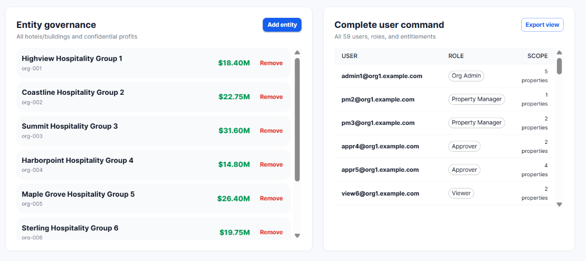
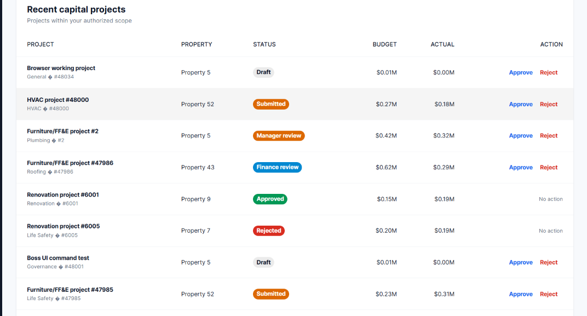
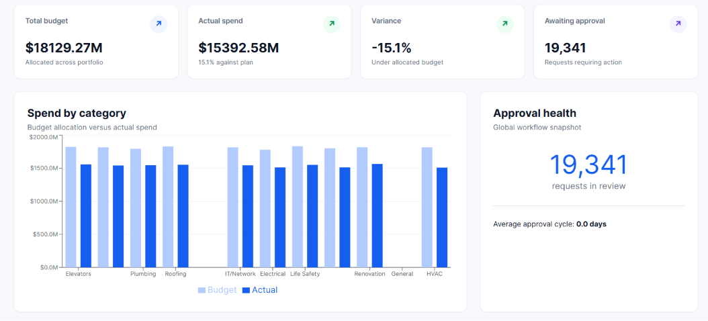

# Blue Ocean Capital Control

Blue Ocean Capital Control is a multi-tenant capital expenditure platform for
hotels, buildings, and operating entities. It brings project budgets, actual
spend, approvals, variance reporting, and executive oversight into one
workspace.

The application has two operating levels:

- **Entity users** work within their organization and assigned properties.
- **Lead Admin** has platform-wide authority across every organization, property,
  project, user, approval, and confidential profit metric.

## Product tour

### Lead Admin command center

The Lead Admin dashboard provides a portfolio-wide view of financial performance,
approval exposure, entity governance, user administration, and current capital
projects.



### Entity and user governance

The The Lead Admin can create and remove operating entities, review confidential
profitability, and manage the complete platform user directory.



### Recent capital projects

Projects are shown with their current workflow status and available action.
The dashboard includes draft, submitted, manager review, finance review,
approved, and rejected examples.



### Portfolio analytics

Budget, actual spend, variance, category performance, and pending approvals
are summarized for the signed-in user's authorized scope.



## Main capabilities

- JWT-based authentication.
- Organization and property-level data isolation.
- Role-based permissions enforced by the API.
- Project creation, editing, submission, approval, rejection, and version
  conflict protection.
- Platform-administrator-only global project and analytics visibility.
- Platform-administrator-only consolidated profit reporting.
- Organization management: add, update, and remove entities.
- Lead Admin user management: add users, assign roles and organizations, and remove
  platform users.
- Budget and actual-spend analytics with category breakdowns.
- CSV exports for project, budget, variance, and approval registers.
- Persisted analytics rollups refreshed through Celery.
- Redis-backed Channels updates for tenant-scoped activity.
- Responsive React dashboard with Blue Ocean branding.

## Roles and access

| Role | Scope | Typical capabilities |
| --- | --- | --- |
| `super_admin` | Entire platform | Full Lead Admin authority, including entities, users, projects, approvals, analytics, and confidential profits |
| `org_admin` | One organization | Manage projects and view organization-wide budgets and analytics |
| `property_manager` | Assigned properties | Create and manage projects for assigned properties |
| `approver` | Authorized organization/properties | Advance approval workflows and reject requests |
| `viewer` | Authorized organization/properties | Read-only access to permitted projects and analytics |

Authorization is checked on the server. Changing a browser URL or project ID
does not bypass organization, property, or role restrictions.

## Demo accounts

All seeded demo accounts use the password:

```text
Passw0rd!
```

### Lead Admin account

```text
Email:    boss@blueocean.example.com
Password: Passw0rd!
```

The Lead Admin account is not assigned to an organization. It receives global scope
through the `super_admin` role.

### Example organization accounts

```text
admin1@org1.example.com  - organization administrator
pm2@org1.example.com     - property manager
appr4@org1.example.com   - approver
view6@org1.example.com   - viewer
```

The seed dataset contains additional users across the configured
organizations. The exact directory can be viewed from the platform administration
administration panel.

## Running the application

### Requirements

- Docker Desktop with Docker Compose
- PowerShell on Windows, or an equivalent shell
- Git, if cloning the project

### Start the services

From the project root:

```powershell
docker compose up --build -d
```

This starts:

| Service | Purpose | Address |
| --- | --- | --- |
| `frontend` | React/Vite dashboard | http://localhost:5173 |
| `api` | Django REST API | http://localhost:8000 |
| `db` | PostgreSQL database | localhost:5432 |
| `redis` | Celery and Channels transport | localhost:6379 |
| `worker` | Background analytics tasks | - |

The API container applies migrations during startup. If the database is being
initialized for the first time, wait for the API container to become healthy
before loading seed data.

### Load the demo dataset

Generate the deterministic dataset:

```powershell
python harness\seed.py --out .\seed_data
```

Copy it into the API container and load it:

```powershell
docker compose cp seed_data api:/tmp/seed_data
docker compose exec api python manage.py load_seed /tmp/seed_data
```

Create or repair the Lead Admin account:

```powershell
docker compose exec api python manage.py create_boss
```

The seed loader synchronizes database sequences after importing explicit
project and approval-event IDs, so new records can be created safely from the
dashboard.

### Stop or restart

```powershell
docker compose stop
docker compose start
```

To rebuild after source changes:

```powershell
docker compose up --build -d api frontend worker
```

To inspect service status and logs:

```powershell
docker compose ps
docker compose logs -f api
docker compose logs -f frontend
```

## How the workflow works

1. A permitted user creates a capital project for an assigned property.
2. The project starts in `draft`.
3. The project owner submits it:
   `draft -> submitted`.
4. Authorized reviewers advance it through:
   `submitted -> manager_review -> finance_review -> approved`.
5. A permitted approver can reject a project from an active workflow state.
6. Each transition is performed transactionally and checks the project version
   to prevent stale concurrent updates.
7. Analytics are refreshed in the background and the dashboard receives
   tenant-scoped update events.

The The Lead Admin can review and act across the complete platform. Regular users only
see data permitted by their organization, properties, and role.

## Lead Admin administration

From **Lead Admin administration**, the `super_admin` account can:

- Add, update, and remove hotels or buildings.
- View confidential entity profit amounts and consolidated profit.
- Add platform users with a role and organization assignment.
- Remove platform users after confirmation.
- Review every user's role, organization, and property scope.
- Manage projects and approval actions globally.
- Export platform registers for operational review.

The active Lead Admin account is protected from accidental self-removal in the
dashboard. The API also restricts all platform user and organization
administration endpoints to `super_admin`.

## API overview

The API is served from `http://localhost:8000/api`.

| Endpoint | Purpose |
| --- | --- |
| `POST /auth/login/` | Obtain access and refresh JWT tokens |
| `GET /projects/` | List projects within the caller's scope |
| `POST /projects/` | Create a project when permitted |
| `POST /projects/{id}/submit/` | Submit a draft project |
| `POST /projects/{id}/approve/` | Advance or reject an approval |
| `GET /analytics/` | Return scoped analytics |
| `GET /organizations/` | Organization directory |
| `POST /organizations/` | Lead Admin entity creation |
| `PATCH /organizations/{id}/` | Lead Admin entity update |
| `DELETE /organizations/{id}/` | Lead Admin entity removal |
| `GET /platform/users/` | Lead Admin user directory |
| `POST /platform/users/` | Platform user creation |
| `PATCH /platform/users/{id}/` | Platform user role/scope update |
| `DELETE /platform/users/{id}/` | Platform user removal |

All protected endpoints require:

```http
Authorization: Bearer <access-token>
```

## Testing and checks

Run backend checks and tests:

```powershell
docker compose exec api python manage.py check
docker compose exec api python manage.py test core
```

Build the frontend:

```powershell
Set-Location frontend
npm install
npm run build
```

The backend test suite covers tenant isolation and versioned approval
behavior. The frontend build runs TypeScript checking before producing the
production bundle.

## Project structure

```text
backend/
  config/                 Django settings, URLs, ASGI, and Celery setup
  core/                   Models, permissions, API views, services, tasks, tests
  manage.py
frontend/
  src/main.tsx            React dashboard and application interactions
  public/                 Static branding assets
harness/
  seed.py                 Deterministic demo data generator
docs/screenshots/         Product screenshots used in this guide
docker-compose.yml        Local service orchestration
DESIGN.md                 Architecture and security decisions
```

## Configuration notes

Compose uses PostgreSQL, Redis, Django REST Framework, Simple JWT, Celery,
Channels, and Vite. The backend's test configuration can use a lightweight
local database, while the Compose environment provides the full multi-service
runtime.

Before using this application outside a demo environment, replace the demo
passwords, configure secret keys and allowed origins, add production
observability, and review retention, backup, and deployment policies.


